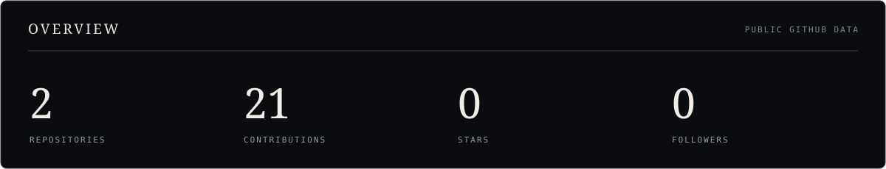
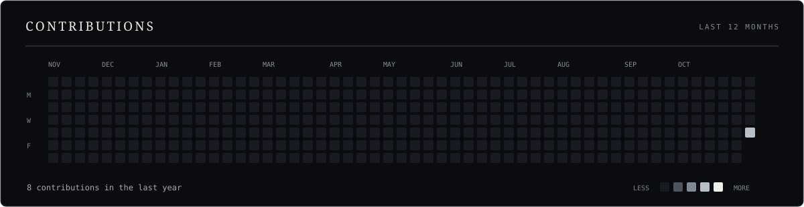
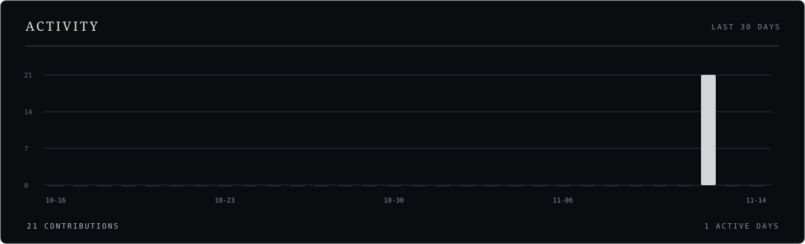
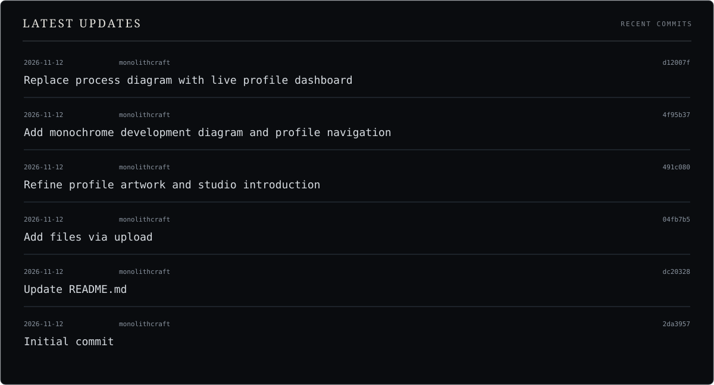
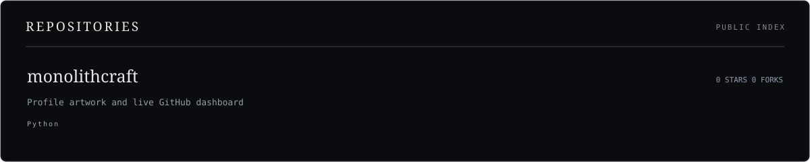
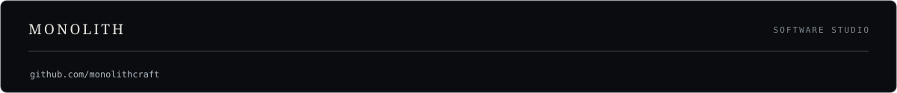

  

  <a href="https://github.com/monolithcraft?tab=repositories">Repositories</a>
  &nbsp;&nbsp;/&nbsp;&nbsp;
  <a href="https://github.com/monolithcraft?tab=projects">Projects</a>
  &nbsp;&nbsp;/&nbsp;&nbsp;
  <a href="https://github.com/monolithcraft/monolithcraft/commits/main">Updates</a>

  

